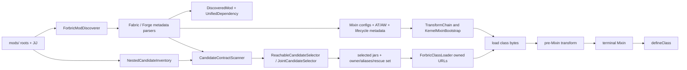

# Forbric 模组发现、元数据与依赖解析结构核验（A 路）

- `producedBy`: `lane_a`
- 核验性质：GitHub 公开仓库静态结构核验
- 核验时间：2026-11-13 20:03 +08:00
- 来源：<https://github.com/Ray-T-r/Minecraft-Forbric-mod-loader>
- 默认分支：`main`
- 分支尖端：`f7f4ff92f67fe8de1a5957efda5cceb4c55d5057`
- 提交时间：`2026-10-23T13:23:15Z`
- 固定提交树：<https://github.com/Ray-T-r/Minecraft-Forbric-mod-loader/tree/f7f4ff92f67fe8de1a5957efda5cceb4c55d5057>

本报告只做了网络侧只读查询：GitHub REST API、GitHub raw 文件与源码行定位。没有 clone、fork 或下载仓库 zip；没有复制源码到本报告；没有下载 jar/release；没有运行 Gradle、测试或 Minecraft。下文“入口”指调用关系的起点，不表示本轮实际执行过。

## 1. 结论先行

当前 `main` 不是单一的“旧 Forbric 加载器”。仓库同时保留两套可以辨认的实现：

- `forbric-kernel/` 是当前主实现。其 README 明确称它为 ground-up rewrite，并把旧 `forbric-loader/` 描述为仍可运行、用于差分对照的旧“welding”方案：[\`forbric-kernel/README.md\` 第 5、14-20、155-157 行](https://github.com/Ray-T-r/Minecraft-Forbric-mod-loader/blob/f7f4ff92f67fe8de1a5957efda5cceb4c55d5057/forbric-kernel/README.md#L5-L20)。
- `forbric-loader/` 是旧实现/差分基线。它仍有自己的统一发现、元数据、映射和 transform 层，但其模组生命周期依赖真实 Fabric Knot、真实 FML discovery 和 FML `ModSorter`。

因此，后续若做“原版 Forbric / 替换前 / 替换后”对照，必须先把实现指纹固定到具体模块和 commit。不能把 `forbric-kernel/.../discovery` 与 `forbric-loader/.../discovery` 当成同一实现，也不能混用两者的依赖解析语义。

当前内核的核心分层是：

1. **BOOT side**：文件扫描、双/三 manifest 识别、元数据解析、候选清单、依赖/Mixin/符号契约建模、物理 jar 选择、生命周期编排。
2. **GAME side**：唯一的 `ForbricClassLoader` 读取已选 jar 的 class bytes，依次执行统一 transform chain、终端 Mixin 和 `defineClass`。

这条边界不是“BOOT 完全不读 class bytes”。`CandidateContractScanner` 在 BOOT side 用 ASM 静态阅读字节码，供候选选择使用；但它不定义类、不初始化类、不执行 transform、不运行 Mixin。真正的类定义发生在后续 `ForbricClassLoader`。

## 2. 仓库顶层结构

GitHub 递归 tree API 在固定提交上返回 `truncated=false`。与结构核验相关的主要顶层单元如下：

| 顶层路径 | 角色 | 与本次问题的关系 |
|---|---|---|
| `forbric-kernel/` | 当前自主内核；README 称其取代旧 loader 的 welded 架构 | 主发现、主元数据、主候选裁决、主 transform、主 classloader |
| `forbric-loader/` | 旧 welded loader，仍作为差分对照保留 | 旧发现/元数据/映射/transform；Knot 实际类加载；FML 自身 sort |
| `forbric-kernel-installer/` | 内核安装器、运行准备 | 不承载模组发现或依赖选择 |
| `forbric-installer/` | 旧 loader 安装器 | 不承载模组发现或依赖选择 |
| `forbric-kernel/canary/` | 行为、兼容性和负向夹具 | 主要用于核验，不应与生产实现混淆 |
| `bootstrap.sh` | 旧 loader 的 Fabric substrate 获取与 patch 应用脚本 | 只有旧实现需要；本轮没有执行 |
| `tools/` | 开发、JUnit 报告和夜间运行工具 | 不是 loader 运行时发现入口 |

内核 README 的“两侧”定义见 [\`forbric-kernel/README.md\` 第 29-41 行](https://github.com/Ray-T-r/Minecraft-Forbric-mod-loader/blob/f7f4ff92f67fe8de1a5957efda5cceb4c55d5057/forbric-kernel/README.md#L29-L41)：BOOT side 负责 classloading、discovery、dependency resolution、transform、Mixin、mapping、access、metadata；GAME side 是唯一 transforming classloader 上运行的代码。

## 3. 当前内核：模组发现

主目录：

```text
forbric-kernel/src/main/java/net/forbric/kernel/
├── boot/
├── discovery/
├── fabric/
├── metadata/
│   ├── fabric/
│   └── forge/
└── classloading/
```

### 3.1 统一 manifest 发现

主入口是 [\`discovery/ForbricModDiscoverer.java\`](https://github.com/Ray-T-r/Minecraft-Forbric-mod-loader/blob/f7f4ff92f67fe8de1a5957efda5cceb4c55d5057/forbric-kernel/src/main/java/net/forbric/kernel/discovery/ForbricModDiscoverer.java)。

- 类与职责概述：第 41-55 行。
- `discover(Path)`：第 63 行，遍历 `mods/` 下的 jar。
- `discoverJar(Path)`：第 111 行，按 jar 读取并按 jar 缓存解析结果。
- `parseJar(...)`：第 126 行，识别 `fabric.mod.json`、`META-INF/neoforge.mods.toml`、`META-INF/mods.toml`。
- 一个 jar 可同时产生 Fabric 与 Forge-family 记录；真正选哪个生态由后续 arbitration 决定。
- 解析失败进入 `MetadataFailures`，不是静默忽略。

产物是统一模型 [\`net.forbric.api.DiscoveredMod\`](https://github.com/Ray-T-r/Minecraft-Forbric-mod-loader/blob/f7f4ff92f67fe8de1a5957efda5cceb4c55d5057/forbric-kernel/src/main/java/net/forbric/api/DiscoveredMod.java#L26-L42)，带 ecosystem、id、version、dependencies、Mixin configs、access config/AT、source、aliases、mod properties 与配置元素。

### 3.2 Fabric 专用发现

更完整的 Fabric 路径是 [\`fabric/FabricModDiscovery.java\`](https://github.com/Ray-T-r/Minecraft-Forbric-mod-loader/blob/f7f4ff92f67fe8de1a5957efda5cceb4c55d5057/forbric-kernel/src/main/java/net/forbric/kernel/fabric/FabricModDiscovery.java)。

- 类与职责：第 38-48 行。
- `discover(Path)`：第 109 行。
- `discoverPlanned(NestedCandidatePlan)`：第 213 行，消费已经选定的物理候选，不再二次决版。
- `discoverJar(...)`：第 264 行，读取 `fabric.mod.json` 并递归 Fabric JiJ。
- `classpathJars`：第 103-105 行，记录最终可进入 class loader 的物理 jar。

### 3.3 物理 jar/JiJ 清单

[\`boot/NestedCandidateInventory.java\`](https://github.com/Ray-T-r/Minecraft-Forbric-mod-loader/blob/f7f4ff92f67fe8de1a5957efda5cceb4c55d5057/forbric-kernel/src/main/java/net/forbric/kernel/boot/NestedCandidateInventory.java#L21-L43) 在任一生态过滤 root 之前建立完整物理候选图：

- root/nested 节点、内容摘要、候选 claim；
- `META-INF/jars/` 与 `META-INF/jarjar/` 边；
- JarJar coordinate/version；
- 不可读、深度/大小有界等 issue；
- Fabric nested requirements 的 left-out/kept-back 状态。

入口 `scan(...)` 在 [第 251-258 行](https://github.com/Ray-T-r/Minecraft-Forbric-mod-loader/blob/f7f4ff92f67fe8de1a5957efda5cceb4c55d5057/forbric-kernel/src/main/java/net/forbric/kernel/boot/NestedCandidateInventory.java#L251-L258)。

`ModAnnotationScanner` 与 `ModFileScanner` 属于**发现/索引辅助层**：

- `ModAnnotationScanner` 从字节码定位 `@Mod`/订阅者类；
- `ModFileScanner` 构建 NeoForge/Forge 的 annotation/class scan data，且是 lazy；
- 两者都不执行模组构造器或静态初始化。

## 4. 当前内核：元数据解析

### 4.1 Fabric

目录：`forbric-kernel/src/main/java/net/forbric/kernel/fabric/`

- 完整 Fabric 元数据入口：[`FabricModMetadataParser.read(...)`](https://github.com/Ray-T-r/Minecraft-Forbric-mod-loader/blob/f7f4ff92f67fe8de1a5957efda5cceb4c55d5057/forbric-kernel/src/main/java/net/forbric/kernel/fabric/FabricModMetadataParser.java#L53-L68)。
- entrypoint、JiJ、Mixin、access widener、provides 与 dependency 的解析说明在类头第 53-60 行。
- dependency 表读取在 `dependencies(...)` 第 194 行。
- 面向统一 `DiscoveredMod` 的轻量 reader 在 `metadata/fabric/FabricModJsonReader.java`，入口第 47/51 行。

边界含义：完整 parser 为 FabricLoader API、entrypoint 和生命周期提供 metadata；轻量 reader 为统一发现/审计提供 `DiscoveredMod`。后续 candidate arbitration 也会再次读取 metadata，而不是仅凭类名或文件名。

### 4.2 Forge / NeoForge

目录：`forbric-kernel/src/main/java/net/forbric/kernel/metadata/forge/`

- TOML 入口：`ModsTomlParser.parse(...)`，[第 47-55 行](https://github.com/Ray-T-r/Minecraft-Forbric-mod-loader/blob/f7f4ff92f67fe8de1a5957efda5cceb4c55d5057/forbric-kernel/src/main/java/net/forbric/kernel/metadata/forge/ModsTomlParser.java#L43-L55)。
- dependency 解析：`parseDependencies(...)`，第 181 行。
- 统一模型映射：`ForgeMetadataMapper.toDiscoveredMods(...)`，[第 89 行起](https://github.com/Ray-T-r/Minecraft-Forbric-mod-loader/blob/f7f4ff92f67fe8de1a5957efda5cceb4c55d5057/forbric-kernel/src/main/java/net/forbric/kernel/metadata/forge/ForgeMetadataMapper.java#L89-L138)。
- Maven range 转 Fabric predicate：`ForgeVersionRangeTranslator.toFabricPredicate(...)`，[第 43 行](https://github.com/Ray-T-r/Minecraft-Forbric-mod-loader/blob/f7f4ff92f67fe8de1a5957efda5cceb4c55d5057/forbric-kernel/src/main/java/net/forbric/kernel/metadata/forge/ForgeVersionRangeTranslator.java#L39-L43)。
- `EcosystemVersions`、`FmlConfigElements`、`LanguageProviders` 也在此目录，分别提供平台版本事实、FML config element 和语言适配信息。

统一 dependency 模型是 [\`net.forbric.api.UnifiedDependency\`](https://github.com/Ray-T-r/Minecraft-Forbric-mod-loader/blob/f7f4ff92f67fe8de1a5957efda5cceb4c55d5057/forbric-kernel/src/main/java/net/forbric/api/UnifiedDependency.java#L23-L42)：id、Fabric 风格版本谓词、是否 mandatory、ordering、side scope、`isSatisfiedBy`、`appliesOn`。

版本谓词集中在 [\`net.forbric.api.VersionPredicate\`](https://github.com/Ray-T-r/Minecraft-Forbric-mod-loader/blob/f7f4ff92f67fe8de1a5957efda5cceb4c55d5057/forbric-kernel/src/main/java/net/forbric/api/VersionPredicate.java#L24-L75)。它刻意区分 fail-open 的诊断 `matches` 与严格准入 `matchesStrictly`。

## 5. 当前内核：依赖与候选选择

依赖相关代码不是只有一个“SAT solver”。它分成四层：

| 层 | 入口 | 职责 |
|---|---|---|
| 物理候选图 | `NestedCandidateInventory.scan` | 展开 root + nested jar，记录身份、版本、JarJar edge 和 bounds |
| 契约提取 | `CandidateContractScanner.scanPhysical` | 从 manifest、static annotation、entrypoint/Mixin 的静态字节码闭包中建立 dependency/conflict/symbol 规则 |
| 布尔/精确选择 | `ReachableCandidateSelector.solve`；通用模型 `JointCandidateSelector.solve` | 在候选 jar 之间选择可同时满足的物理集合；状态包括 SOLVED / UNPROVED / UNSATISFIABLE / SEARCH_LIMIT |
| 选择后审计 | `DependencyAudit.report` | 对已选集合检查缺失或版本不满足的硬依赖，并报告 JSON 风格的可解释原因 |

### 5.1 编排入口

`DuplicateModArbiter.arbitrate(...)` 是整机候选裁决入口：

- 类说明：[\`DuplicateModArbiter.java\` 第 52-73 行](https://github.com/Ray-T-r/Minecraft-Forbric-mod-loader/blob/f7f4ff92f67fe8de1a5957efda5cceb4c55d5057/forbric-kernel/src/main/java/net/forbric/kernel/boot/DuplicateModArbiter.java#L52-L73)。
- 生产入口 `arbitrate(modsDir, envType, minecraftVersion)`：第 187 行。
- 调 `NestedCandidateInventory.scan`：第 218 行。
- 调 `CandidateContractScanner.scanPhysical`：第 238 行。
- 调 `ReachableCandidateSelector.solve`：第 240 行。
- 生成 `NestedCandidatePlan` 并记录 suppressed/owner/aliases/rescueJars：第 261-276 行。

`KernelBoot.launch(...)` 在创建 class loader 之前调用这一入口，[第 209-257 行](https://github.com/Ray-T-r/Minecraft-Forbric-mod-loader/blob/f7f4ff92f67fe8de1a5957efda5cceb4c55d5057/forbric-kernel/src/main/java/net/forbric/kernel/boot/KernelBoot.java#L209-L257)。

### 5.2 契约扫描

[\`CandidateContractScanner.java\`](https://github.com/Ray-T-r/Minecraft-Forbric-mod-loader/blob/f7f4ff92f67fe8de1a5957efda5cceb4c55d5057/forbric-kernel/src/main/java/net/forbric/kernel/boot/CandidateContractScanner.java#L21-L79) 只读证据：

- mandatory dependency；
- `breaks` / `conflicts`；
- declared Mixin target/member；
- entrypoint 可达代码中的静态成员引用；
- helper closure 有界静态遍历；
- 不能证明的项进入 UNPROVED/uncertain，而不是视为满足。

这一层会读取 class bytes，并处理 Mixin/ASM 结构，但仍不定义、初始化或执行任何类。因此它仍位于“选择/分析域”，不是运行时 transform。

### 5.3 选择器

[\`ReachableCandidateSelector.java\`](https://github.com/Ray-T-r/Minecraft-Forbric-mod-loader/blob/f7f4ff92f67fe8de1a5957efda5cceb4c55d5057/forbric-kernel/src/main/java/net/forbric/kernel/boot/ReachableCandidateSelector.java#L14-L35) 建模“nested candidate 只能通过已选 parent 到达”：

- 每个 identity 最多选一个物理候选；
- root、JarJar parent-child、依赖、exclusion、override pin 都变成约束；
- 有工作上限，但使用 conflict/check 预算而非 wall-clock，以保持确定性；
- `solve` 在第 102 行，搜索在 `search()` 第 133 行。

[\`JointCandidateSelector.java\`](https://github.com/Ray-T-r/Minecraft-Forbric-mod-loader/blob/f7f4ff92f67fe8de1a5957efda5cceb4c55d5057/forbric-kernel/src/main/java/net/forbric/kernel/boot/JointCandidateSelector.java#L9-L53) 是通用的 bounded exact-cover search，规则可表示“若 consumer 被选，则至少一个 proved provider 必须被选”或 exclusion。

### 5.4 Nested Fabric 规则与后置审计

[\`NestedFabricRequirements.java\`](https://github.com/Ray-T-r/Minecraft-Forbric-mod-loader/blob/f7f4ff92f67fe8de1a5957efda5cceb4c55d5057/forbric-kernel/src/main/java/net/forbric/kernel/fabric/NestedFabricRequirements.java#L55-L97) 处理嵌套 Fabric mod 的平台依赖、left-out、kept-back 传播。`resolve(...)` 在 [第 255 行](https://github.com/Ray-T-r/Minecraft-Forbric-mod-loader/blob/f7f4ff92f67fe8de1a5957efda5cceb4c55d5057/forbric-kernel/src/main/java/net/forbric/kernel/fabric/NestedFabricRequirements.java#L255-L297)。

[\`DependencyAudit.java\`](https://github.com/Ray-T-r/Minecraft-Forbric-mod-loader/blob/f7f4ff92f67fe8de1a5957efda5cceb4c55d5057/forbric-kernel/src/main/java/net/forbric/kernel/boot/DependencyAudit.java#L39-L59) 的类注释描述了它的定位：组合集合没有另一个 loader 的 resolver 自动替它判定时，它检查已安装集合中的硬依赖、版本与跨生态 provider；它是**诊断/准入报告**，不是候选选择器本身。

### 5.5 加载顺序

依赖选择与初始化顺序是两个概念：

- `KernelFabricEcosystem.orderByDependency(...)`：第 623 行，先给出依赖顺序。
- 默认开启 `FabricLoadOrder` 时，随后按 mod id 重排，以模拟 Fabric 生命周期顺序；说明在第 610-680 行。
- `FabricLoadOrder` 本身在 `boot/FabricLoadOrder.java`，入口 `byModId(...)` 第 107 行。

因此“选到哪些 jar”与“按什么顺序运行 entrypoint”必须分别记录，不能用一个字段混称。

## 6. 当前内核：与 transform / 类加载层的边界

### 6.1 class loader 的构造点

`KernelBoot.launch(...)` 在完成以下工作后才构造 class loader：

- top-level duplicate 仲裁；
- Forge-family/Fabric 发现；
- nested candidate 选择；
- classpath jar 集合组合；
- rescue jar 与 jar-family 映射。

`new ForbricClassLoader(...)` 在 [第 355-356 行](https://github.com/Ray-T-r/Minecraft-Forbric-mod-loader/blob/f7f4ff92f67fe8de1a5957efda5cceb4c55d5057/forbric-kernel/src/main/java/net/forbric/kernel/boot/KernelBoot.java#L355-L356)；rescue jar 与 family map 的安装在第 369、373 行。

### 6.2 transform chain

`TransformChain` 在 loader 构造之后建立，第 389 行起。安装到 loader 的位置是 [第 1192 行](https://github.com/Ray-T-r/Minecraft-Forbric-mod-loader/blob/f7f4ff92f67fe8de1a5957efda5cceb4c55d5057/forbric-kernel/src/main/java/net/forbric/kernel/boot/KernelBoot.java#L1192)。

固定阶段见 [\`TransformPhase.java\` 第 20-52 行](https://github.com/Ray-T-r/Minecraft-Forbric-mod-loader/blob/f7f4ff92f67fe8de1a5957efda5cceb4c55d5057/forbric-kernel/src/main/java/net/forbric/kernel/transform/TransformPhase.java#L20-L52)：

`RAW_PATCH -> DEOBF_REMAP -> ENV_STRIP -> ACCESS -> COREMOD -> FABRIC_BUILTIN -> MIXIN`

其中 `MIXIN` 是终端且不能在 `TransformChain` 中注册；Mixin 由 class delegate 在 chain 之后调用。

### 6.3 Mixin 安装点

`KernelMixinBootstrap.init(...)` 在 [\`KernelBoot.java\` 第 1282 行](https://github.com/Ray-T-r/Minecraft-Forbric-mod-loader/blob/f7f4ff92f67fe8de1a5957efda5cceb4c55d5057/forbric-kernel/src/main/java/net/forbric/kernel/boot/KernelBoot.java#L1248-L1283) 调用；具体安装 weaver 在 [\`KernelMixinBootstrap.java\` 第 62-78、121-177 行](https://github.com/Ray-T-r/Minecraft-Forbric-mod-loader/blob/f7f4ff92f67fe8de1a5957efda5cceb4c55d5057/forbric-kernel/src/main/java/net/forbric/kernel/mixin/KernelMixinBootstrap.java#L62-L78)。

该 bootstrap 的职责是把 Mixin 作为最后阶段挂到 loader，不参与 discovery 或候选选择。

### 6.4 每次类定义的路径

[\`ForbricClassLoader.java\` 第 41-53 行](https://github.com/Ray-T-r/Minecraft-Forbric-mod-loader/blob/f7f4ff92f67fe8de1a5957efda5cceb4c55d5057/forbric-kernel/src/main/java/net/forbric/kernel/classloading/ForbricClassLoader.java#L41-L53) 定义其为唯一 sovereign transforming classloader。

- `loadClass(...)`：第 441 行；
- `tryDefineGameClass(...)`：第 480 行；
- 读取 owned jar 成为 pre-Mixin bytes：第 484-527 行；
- Mixin：第 533 行；
- 最终 `define` / `defineClass`：第 545、638-648 行。

边界因此可写成：

| 前置域（BOOT；输入是文件与静态字节） | 类加载/transform 域（GAME；输入是已选 class bytes） |
|---|---|
| 发现 manifest、解析 metadata、展开 JiJ、建立候选图 | 按已选 URL 查找 class resource |
| 静态扫描 annotation/entrypoint/Mixin/symbol，裁掉不兼容候选 | 对 class bytes 运行 `TransformChain` |
| 输出 selected roots/nested、owner、aliases、rescue jars | 运行终端 Mixin |
| 输出 Mixin config、AT/AW、依赖与 side facts | `defineClass`，随后 JVM 链接/初始化 |

### 6.5 结构化边界图



这张图只表达结构，不表示本轮执行了其中任一段。

## 7. 旧 `forbric-loader` 的对应结构

旧实现仍在固定提交中，目录为 `forbric-loader/src/main/java/net/forbric/loader/impl/`：

| 关注点 | 路径 | 入口/边界 |
|---|---|---|
| 发现 | `discovery/ForbricModDiscoverer.java` | `discover(Path)`、`discoverJar(Path)`；识别三种 manifest |
| Fabric 元数据 | `metadata/fabric/FabricModJsonReader.java` | `read(...)`；类注释说明整合构建会换成 Fabric Loader 的 parser |
| Forge 元数据 | `metadata/forge/ModsTomlParser.java` | `parse(...)` |
| 统一映射 | `metadata/forge/ForgeMetadataMapper.java` | `toDiscoveredMods(...)` |
| 版本转换 | `metadata/forge/ForgeVersionRangeTranslator.java` | Maven range -> Fabric predicate |
| 依赖进入 resolver | `mapping/ForgeModRemapper.java` | 包装 jar 时注入 synthetic `fabric.mod.json` 的 `depends`/`recommends`，交给 substrate 的同一 SAT solve |
| 启动前编排 | `launch/ForbricBootstrap.java` | 调 unified discovery、安装 `TransformChain`、准备 Forge jar、通过 `fabric.addMods` 交给 Knot |
| 类加载 | 外部 pinned Fabric substrate / `Knot` | 本仓库只保留 8 个 patch；`bootstrap.sh` 才拉取外部 fabric-loader |
| transform | `transformer/*` | `FabricTransformer` patch -> `ForbricTransformBridge` -> `TransformChain` |
| Forge 运行时 sort | `forge/minecraftforge/ForbricFmlDiscovery.java`、`forge/neoforge/ForbricNeoFmlDiscovery.java` | 在 Knot 下反射调用真实 FML `ModFileParser` 与 `ModSorter.sort`，再安装 `LoadingModList` |

旧实现关键入口与边界：

- 客户端：`launch/ForbricClient.main` -> `ForbricBootstrap.run` -> `Knot.launch`。
- 服务端：`launch/ForbricServer.main` -> 同一 bootstrap -> `Knot.launch`。
- `FabricTransformer` 的补丁把 substrate 的 pre-Mixin path 接给 `ForbricTransformBridge`。
- 真实类加载仍由 Knot 完成；旧实现的 `ForbricFmlDiscovery` 在 Knot 内安装 Forge `LoadingModList`。
- `forbric-loader/build.gradle` 从外部 `../fabric-loader` 编译 substrate；`bootstrap.sh` 固定 `fabric_loader_ref = 0.19.3`，并应用仓库内 patch。本轮没有执行 `bootstrap.sh`。

新内核与旧 loader 的关键结构差异：

- 新内核自己持有 `KernelFabricLoader` 接口视图和 entrypoint/lifecycle；
- 新内核自己持有 `ForbricClassLoader`，不再由 Knot 定义游戏/模组类；
- 新内核候选选择覆盖 tri-ecosystem 物理 jar 集合，旧 loader 的发现输出再经包装进入 substrate/real FML；
- 旧 loader 仍运行真实 Fabric/Knot 与真实 FML sort，适合作为差分基线，但同名目录不能视为相同实现。

## 8. 入口清单

| 用途 | 入口 | 备注 |
|---|---|---|
| 独立统一发现报告 | `forbric-kernel/src/main/java/net/forbric/kernel/boot/Main.java#L47-L74` | `--scan --mods <dir> --report <json>`；README 称其为 deterministic oracle anchor |
| 生产客户端 | `forbric-kernel/src/main/java/net/forbric/kernel/boot/KernelClientLaunch.java#L32-L34` | 调 `KernelBoot.launch(CLIENT, args)` |
| 生产服务端 | `forbric-kernel/src/main/java/net/forbric/kernel/boot/KernelServerLaunch.java#L31-L32` | 调 `KernelBoot.launch(SERVER, args)` |
| 整机编排 | `KernelBoot.launch` | 发现 -> 候选选择 -> classpath -> classloader -> transform/Mixin |
| 统一 manifest 发现 | `ForbricModDiscoverer.discover` / `discoverJar` | independent of loader construction |
| Fabric 发现 | `FabricModDiscovery.discover` | JiJ and selected plan |
| 依赖/候选选择 | `DuplicateModArbiter.arbitrate` | inventory + contracts + selector + plan |
| 类定义 | `ForbricClassLoader.loadClass` -> `tryDefineGameClass` | chain then Mixin then define |

## 9. 实跑与验证边界

本轮没有运行仓库代码，因此以下都只能写成“代码结构显示”，不能写成运行时已验证：

- 没有运行 `forbric-kernel --scan`；
- 没有运行 `gradle test`；
- 没有启动 Minecraft；
- 没有加载类、执行 Mixin 或 transform；
- 没有下载 jar；
- 没有验证某一具体模组批次的选择结果。

GitHub API 读取、raw 文件读取与路径/行号定位是实际完成的；仓库返回的错误没有发生，因此本报告无需粘贴“不可达”原文。

## 10. AGENTS.md 交接

### 改了哪些文件

- 新增：`forbric-comparison/architecture-A.md`
- 修改：无
- 删除：无
- `src/`：未改
- `SPEC.md` / `SPEC.zh-CN.md`：未改
- `AGENTS.md`：未改
- `PROGRESS.md`：未改，主智能体负责总账

### 测试数字

- 测试数 / 失败 / 错误 / 跳过：没跑，原因是本轮 A 路限定为外部仓库只读结构核验，不运行 Forbric 代码。
- 命令：没有 `gradle test`、没有 `gradle run`、没有 Minecraft 启动命令。

### 关键数字

- 核验提交：1 个，`f7f4ff92f67fe8de1a5957efda5cceb4c55d5057`。
- 分支：`main`，固定提交核验时尖端与上述 SHA 一致。
- GitHub recursive tree：`truncated=false`；未做全仓下载。
- 与本地 modgraph 基线对比：不适用；本路没有读取或重算本地 M0–M1.5 数字。
- 哈希变化：本地受保护文件未改；A 路不产生或比较 jar 哈希。

### 违反哪条禁令

无。A 路没有 clone/fork、没有下载 jar、没有复制源码进产物、没有改受保护文件、没有运行测试/游戏、没有 git 写操作。GitHub API 与 raw 文件读取属于只读外部核验，符合用户给定范围。

### 未验证 / 已知局限

- 没有运行任何构建，无法确认当前提交在特定 JDK/平台上可编译或可启动。
- 没有运行 crates/jars，不验证运行时行为。
- 行号来自固定提交；若上游 `main` 前移，路径与行号需按新 commit 重取。
- 作为差分基线的“原版 Forbric”究竟指旧 `forbric-loader/` 还是当前 `forbric-kernel/`，需要另设 cohort 定义；本报告只指出仓库同时存在两套实现，不替维护者裁决。

### 下一步第一条命令

本轮没有执行，也不应由 A 路自动执行：

```powershell
git -C D:\modgraph\modgraph status --short --untracked-files=all
```
